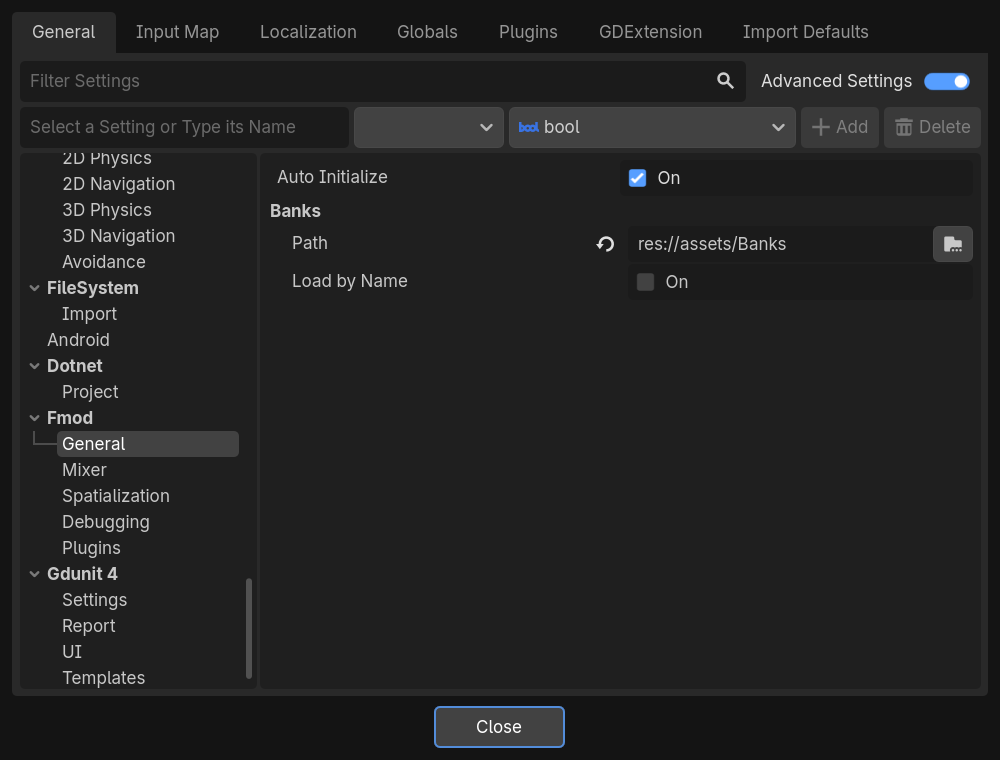

# General

Whether FMOD starts by itself, and where your banks are.

## Auto Initialize

| **Project Setting** | `Fmod/General/auto_initialize` |
|---|---|
| **Default** | On |

Starts FMOD when the game starts, with the Project Settings.

Turn it off to start FMOD yourself with `FmodServer.init()`, for example to apply settings the player chose in an
options menu first. See [Initialization](../user-guide/2-initialization.md).

The editor always starts FMOD, whatever this setting says, to show your banks and let you audition events.

## Banks

### Path

| **Project Setting** | `Fmod/General/banks/path` |
|---|---|
| **Property** | `banks_path` |
| **Default** | `res://` |

The folder holding the banks you build with FMOD Studio. The editor loads the banks it finds there to fill the FMOD
explorer and the event pickers of the FMOD nodes.

Point it to the folder FMOD Studio builds into, inside your project. That folder must hold `Master.strings.bank` and
`Master.bank`.

### Load by Name

| **Project Setting** | `Fmod/General/banks/load_by_name` |
|---|---|
| **Property** | `load_by_name` |
| **Default** | Off |

How FMOD event emitters find their event and its parameters:

- **Off:** by GUID and ID, the identifiers FMOD Studio gives them. Renaming or moving an event in FMOD Studio does not
  break your scenes.
- **On:** by path and name, such as `event:/Weapons/Explosion`. Deleting an event and creating one with the same path
  keeps your scenes working, but renaming or moving one breaks them.
