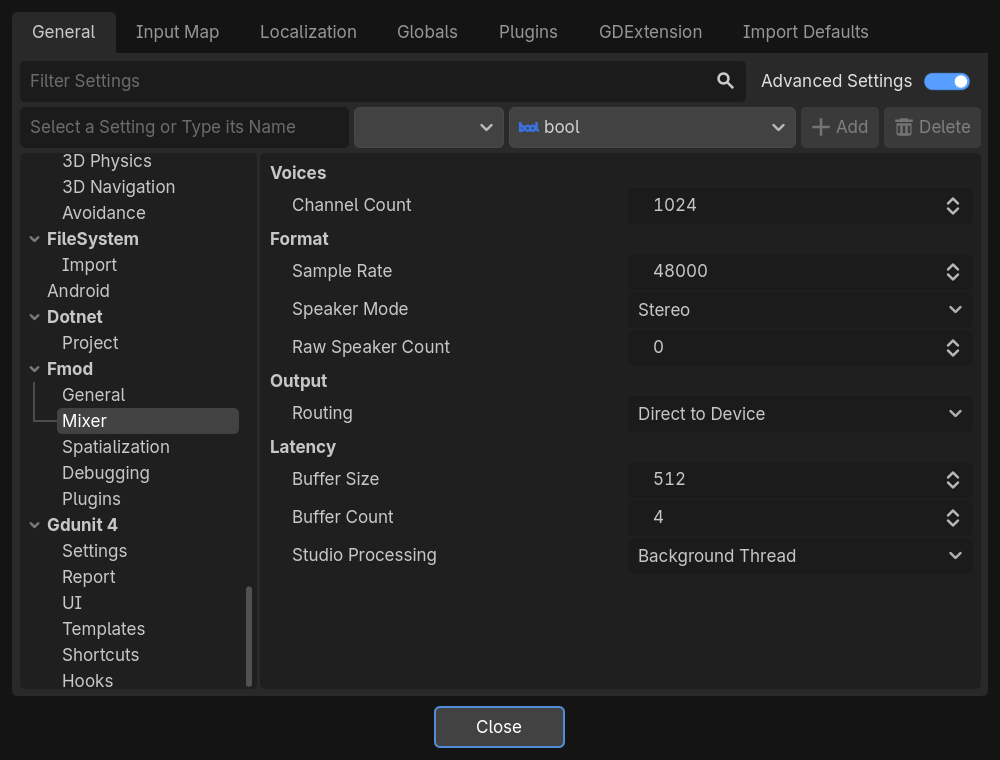
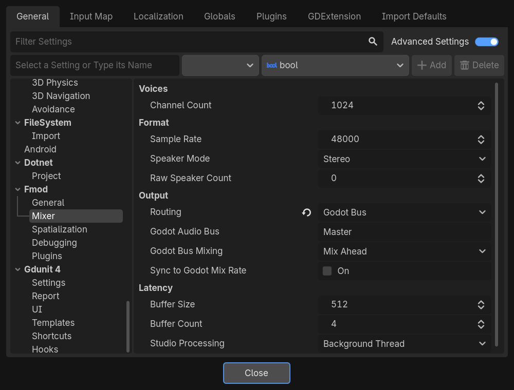

# Mixer

How many sounds FMOD plays, the format it mixes in, where its sound goes, and how much delay it trades for stability.

## Voices

### Channel Count

| **Project Setting** | `Fmod/Mixer/voices/channel_count` |
|---|---|
| **Property** | `channel_count` |
| **Default** | 1024 on desktop, 512 on mobile and the web |
| **Values** | 1 to 4095 |

The most sounds FMOD keeps track of at once, also called virtual voices. FMOD only mixes the most audible of them and
keeps the others silent but running, so they resume where they would be when they become audible again.

Raise it if sounds stop starting in busy scenes. A sound tracked but not mixed costs very little.

## Format

### Sample Rate

| **Project Setting** | `Fmod/Mixer/format/sample_rate` |
|---|---|
| **Property** | `sample_rate` |
| **Default** | 48000 |
| **Values** | 8000 to 192000 Hz |

The rate FMOD mixes at. When it differs from the output's, the sound is converted, at a small cost in quality and
CPU. Most devices run at 48000 Hz.

With a [Godot bus](#routing), see [Sync to Godot Mix Rate](#sync-to-godot-mix-rate).

### Speaker Mode

| **Project Setting** | `Fmod/Mixer/format/speaker_mode` |
|---|---|
| **Property** | `speaker_mode` |
| **Default** | Stereo |
| **Values** | Default, Raw, Mono, Stereo, Quad, Surround, 5.1, 7.1, 7.1.4 |

The speaker layout FMOD mixes for. *Default* follows the output device. Through a [Godot bus](#routing), FMOD's sound is
mixed down to stereo, whatever this setting says.

### Raw Speaker Count

| **Project Setting** | `Fmod/Mixer/format/raw_speaker_count` |
|---|---|
| **Property** | `raw_speaker_count` |
| **Default** | 0 |
| **Values** | 0 to 32 |
| **Advanced** | Yes |

The number of speakers with the *Raw* speaker mode, where FMOD does no panning between them. Ignored with the other
modes.

## Output

Where FMOD's sound goes. [Output, latency and sync modes](../user-guide/10-output-and-latency.md) explains these
choices in depth, with recipes.

### Routing

| **Project Setting** | `Fmod/Mixer/output/routing` |
|---|---|
| **Property** | `output_routing` |
| **Default** | Direct to Device |
| **Values** | Direct to Device, Godot Bus |

- **Direct to Device:** FMOD plays to the audio device by itself, next to Godot's audio. It keeps its own output device
  and surround layouts. The only choice on the web.
- **Godot Bus:** FMOD's sound plays on one of Godot's audio buses. That bus's effects and volume apply to it, the
  *Mute Game* button of Godot's Game view mutes it, and Movie Maker mode records it. Not available on the web, where
  FMOD plays to the device.

The three settings below only show once Routing is *Godot Bus*.

### Godot Audio Bus

| **Project Setting** | `Fmod/Mixer/output/godot_audio_bus` |
|---|---|
| **Property** | `godot_audio_bus` |
| **Default** | `Master` |

The name of the Godot audio bus FMOD's sound plays on, as written in Godot's Audio panel.

### Godot Bus Mixing

| **Project Setting** | `Fmod/Mixer/output/godot_bus_mixing` |
|---|---|
| **Property** | `godot_bus_mixing` |
| **Default** | Mix Ahead |
| **Values** | Mix Ahead, On Demand |

When FMOD prepares its sound for Godot:

- **Mix Ahead:** FMOD keeps its whole buffers mixed in advance. A heavy FMOD scene does not make Godot's audio crackle,
  but the sound is delayed by [Buffer Size](#buffer-size) × [Buffer Count](#buffer-count) samples.
- **On Demand:** FMOD mixes when Godot asks for sound, adding at most one block of [Buffer Size](#buffer-size) samples
  of delay. Movie Maker recordings stay in step with the frames at any frame rate. A very heavy FMOD scene can make
  the sound crackle on a slow computer.

### Sync to Godot Mix Rate

| **Project Setting** | `Fmod/Mixer/output/sync_to_godot_mix_rate` |
|---|---|
| **Property** | `sync_to_godot_mix_rate` |
| **Default** | Off |
| **Advanced** | Yes |

Makes FMOD mix at Godot's own rate (**Audio → Driver → Mix Rate**) instead of [Sample Rate](#sample-rate), so Godot
does not have to convert FMOD's sound.

## Latency

How much sound FMOD prepares in advance: more is steadier, less is quicker to react.
[Where the delay comes from](../user-guide/10-output-and-latency.md#where-the-delay-comes-from) shows how these
settings add up.

### Buffer Size

| **Project Setting** | `Fmod/Mixer/latency/buffer_size` |
|---|---|
| **Property** | `dsp_buffer_size` |
| **Default** | 512 on desktop, 1024 on mobile and the threaded web, 2048 on the web |
| **Values** | 64 to 8192 samples |

The size of the blocks FMOD mixes, in samples. A sound you trigger can only start at the next block, so smaller blocks
react sooner, while larger ones cost less CPU and resist hiccups better.

### Buffer Count

| **Project Setting** | `Fmod/Mixer/latency/buffer_count` |
|---|---|
| **Property** | `dsp_buffer_count` |
| **Default** | 4, 2 on the web |
| **Values** | 2 to 16 |

How many blocks FMOD keeps ready for the output. More blocks protect against crackles when FMOD or the device is late,
and add their length to the delay.

Raise it if FMOD's sound crackles. On iOS, keep [Buffer Size](#buffer-size) × Buffer Count at 4096 samples or more for
the sound to keep playing on the lock screen.

### Studio Processing

| **Project Setting** | `Fmod/Mixer/latency/studio_processing` |
|---|---|
| **Property** | `studio_processing` |
| **Default** | Background Thread, Main Thread on the web |
| **Values** | Background Thread, Main Thread |
| **Advanced** | Yes |

Where FMOD Studio carries out what your game asks it: starting and stopping events, setting parameters, moving sounds.

- **Background Thread:** FMOD's own thread does it, on its next update. It costs your frames nothing.
- **Main Thread:** `FmodServer.update()` does it, so requests take effect as soon as it runs, at the cost of frame time.
  The single-threaded web build has no other thread.

See [Studio Processing](../user-guide/10-output-and-latency.md#studio-processing) for when to pick each.
