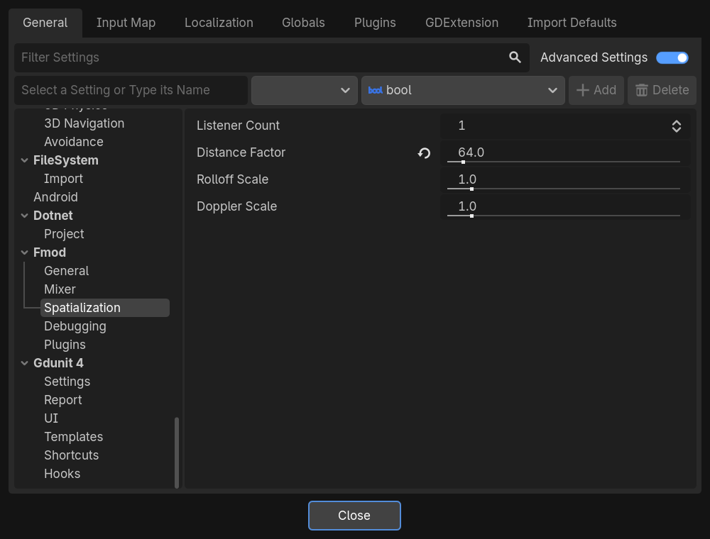

# Spatialization

How sounds are placed around the listeners, in 2D and in 3D.



## Listener Count

| **Project Setting** | `Fmod/Spatialization/listener_count` |
|---|---|
| **Property** | `listener_count` |
| **Default** | 1 |
| **Values** | 1 to 8 |

The number of listeners FMOD starts with. Use more than one for split-screen games, where each player hears the sounds
around their own camera. See [Listeners](../user-guide/6-listeners.md).

## Distance Factor

| **Project Setting** | `Fmod/Spatialization/distance_factor` |
|---|---|
| **Property** | `distance_factor` |
| **Default** | 1 |

The number of game units in one meter. FMOD Studio sets the distances at which events fade in meters, and this setting
converts your game's positions to them.

!!! warning "Set it in 2D games"
    In 2D, game units are pixels. Set Distance Factor to the number of pixels in one meter of your world, such as 64
    if a character 1.8 meters tall is 115 pixels tall. Left at 1, every pixel counts as a meter and sounds fade out far
    too quickly.

In 3D, Godot's units are already meters: keep it at 1.

## Rolloff Scale

| **Project Setting** | `Fmod/Spatialization/rolloff_scale` |
|---|---|
| **Property** | `rolloff_scale` |
| **Default** | 1 |

Scales how fast sounds fade with distance, for sounds using one of FMOD's built-in rolloff curves rather than a custom
one. Above 1, sounds fade sooner; below 1, they carry further.

## Doppler Scale

| **Project Setting** | `Fmod/Spatialization/doppler_scale` |
|---|---|
| **Property** | `doppler_scale` |
| **Default** | 1 |

Scales the pitch change of sounds moving toward or away from a listener, for events with Doppler enabled in FMOD
Studio. 0 turns it off, 2 doubles it.

## Changing them while the game runs

Distance Factor, Rolloff Scale and Doppler Scale can change after FMOD has started, for example per level:

```gdscript
FmodServer.set_spatialization(1.0, 64.0, 1.0)  # Doppler Scale, Distance Factor, Rolloff Scale
```
