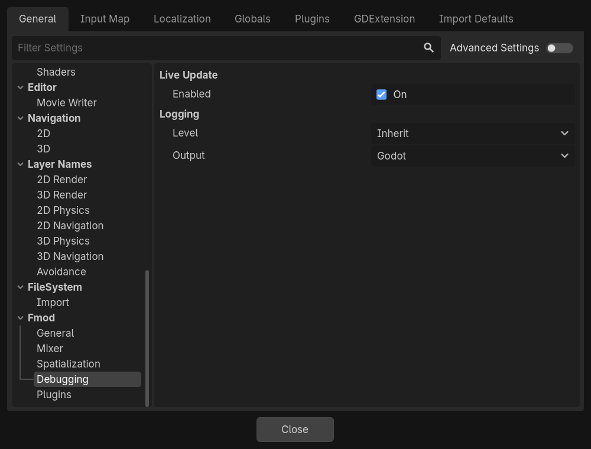

# Debugging

Connecting FMOD Studio to the running game, and FMOD's logs.

## Live Update

### Enabled

| **Project Setting** | `Fmod/Debugging/live_update/enabled` |
|---|---|
| **Property** | `live_update` |
| **Default** | On, off on the web |

Lets FMOD Studio connect to the running game, with **File → Connect to Game**, to change its sounds while you play and
profile them. The game listens on the network for FMOD Studio while it runs.

It never applies in the editor, and FMOD does not support it on the web. To keep it out of the builds you ship, add a
`release` [override](index.md#a-different-value-per-platform) set to off.

### Memory Tracking

| **Project Setting** | `Fmod/Debugging/live_update/memory_tracking` |
|---|---|
| **Property** | `memory_tracking` |
| **Default** | Off |
| **Advanced** | Yes |

Makes FMOD report how much memory each bus and event uses, in FMOD Studio's profiler. It costs a little memory and CPU.

## Logging

### Level

| **Project Setting** | `Fmod/Debugging/logging/level` |
|---|---|
| **Property** | `log_level` |
| **Default** | Inherit |
| **Values** | Inherit, None, Error, Warning, Log, Verbose |

How much FMOD logs:

| Level | Logs |
|---|---|
| Inherit | Errors and warnings, and everything when Godot runs with `--verbose` |
| None | Nothing |
| Error | Errors |
| Warning | Errors and warnings |
| Log | Errors, warnings and information |
| Verbose | Everything, including each FMOD call |

Release exports use FMOD's libraries without logging, so they only log what Godot itself reports.

### Output

| **Project Setting** | `Fmod/Debugging/logging/output` |
|---|---|
| **Property** | `log_output` |
| **Default** | Godot |
| **Values** | TTY, File, Godot |

Where FMOD's messages go:

- **TTY:** the terminal the game runs in.
- **File:** the file of [File Path](#file-path).
- **Godot:** Godot's Output panel and log, next to Godot's own messages.

### File Path

| **Project Setting** | `Fmod/Debugging/logging/file_path` |
|---|---|
| **Property** | `log_file_path` |
| **Default** | `user://fmod.log` |
| **Advanced** | Yes |

The file FMOD writes to, with the *File* output.
