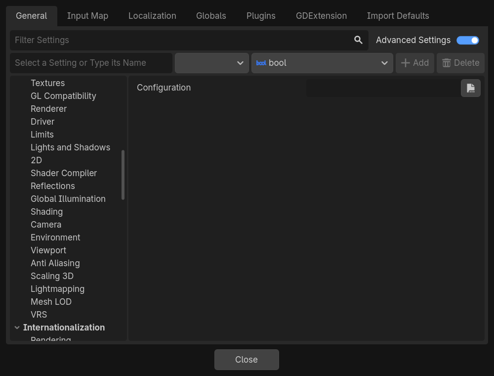

# Plugins

The FMOD plugins your banks need.

## Configuration

| **Project Setting** | `Fmod/Plugins/configuration` |
|---|---|
| **Property** | `plugins` |
| **Default** | None |

The `FmodPluginsSettings` resource listing the FMOD plugins to load: the plugin libraries for each platform, and the
plugins compiled into the game on iOS. FMOD loads them as soon as it starts, before your banks, and exports pack their
libraries.

Leave it empty when your FMOD Studio project uses no third-party plugin. To create the resource and fill it in, see
[Plugins](../user-guide/9-plugins.md).

From code, `plugins` holds the resource itself rather than its path.
